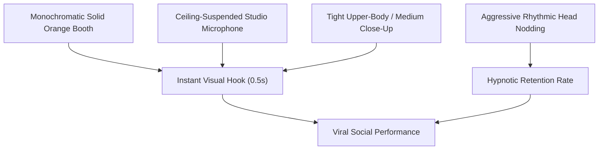

export const meta = {
  title: 'How to Create the Viral Hotel Lobby Rap Effect with AI',
  description:
    'Recreate the viral TikTok Hotel Lobby rap trend inspired by Quavo & Takeoff’s Colors Show. Step-by-step guide to generating the iconic orange studio booth, ceiling mic, and bass-synced head nodding with AI.',
  created_at: '2026-10-24',
  author_name: 'AIRapVideoFree Team',
};

If you have spent more than five minutes scrolling TikTok, Instagram Reels, or YouTube Shorts recently, you have undoubtedly encountered it: an electric, solid monochromatic orange room, a vintage microphone hanging from the ceiling on a single cable, and an unexpected character — whether a beloved pet, an anime hero, a renaissance oil painting, or a friend's awkward selfie — aggressively nodding their head and spitting fast-paced trap bars with unmatched swagger.

This is the **"Hotel Lobby" AI Rap Effect**, one of the most viral and enduring music video memes on the internet. Inspired by Quavo and Takeoff's (Unc & Phew) legendary 2022 live performance of their hit song *"Hotel Lobby"* on Berlin's renowned platform **A COLORS SHOW**, this visual format has accumulated billions of views worldwide.

In this deep-dive guide, we will analyze why this aesthetic is so hypnotic to the human brain, break down its core visual components, and show you step-by-step how to create your own viral Hotel Lobby video for free using [AIRapVideoFree's dedicated Hotel Lobby Effect](/effects/hotel-lobby-rap).

---

## Deconstructing the "Hotel Lobby" Aesthetic

What turns an ordinary studio session into an instantly recognizable, algorithm-dominating visual meme? The magic comes down to five strict visual rules established in the original Colors Show broadcast:



### 1. The Monochromatic Orange Room
Unlike standard music videos packed with shifting backgrounds, lighting rigs, and dizzying cuts, the Colors Show format strips away all visual clutter. The entire set is bathed in a single, ultra-saturated solid hue — in this case, radiant safety orange (#FF5722 / #FF6F00). Because there are no shadows, walls, or furniture, the viewer's eyes are locked squarely on the performer's face and outfit.

### 2. The Suspended Ceiling Microphone
Instead of a floor mic stand that clutters the frame, the performer stands directly beneath a retro studio condenser microphone hanging vertically from a single black wire. This allows the rapper to step into and out of the microphone's sweet spot, naturally leaning forward on punchlines and snapping backward on the drop.

### 3. Synchronized Swag & Aggressive Head Bobs
The hallmark of the Quavo & Takeoff performance is the relentless, rhythm-locked head nod. When the 808 bass drops at ~130 to 140 BPM, the performers nod down on the downbeat and snap up on the snare, giving the visual an intoxicating bounce that loops seamlessly.

### 4. Streetwear Luxury Contrast
The orange background provides the ultimate complementary contrast for hip-hop streetwear:
- Black, cream, or silver oversized designer hoodies
- Layered diamond Cuban link chains that catch the studio rim light
- Sleek dark designer sunglasses
- Clean white sneakers and wrist luxury accessories

---

## Why the Trend Exploded Across TikTok and Reels

Why did this specific format turn into an AI viral sensation?

1. **Instant Thumbnail & Feed Recognition:** In a crowded TikTok or Reels feed, human eyes register the blazing orange square in under 300 milliseconds. It signals high-energy entertainment before the user even reads the caption.
2. **The Comedy of Juxtaposition:** The humor comes from contrast. Taking a dignified historic figure (like Abraham Lincoln, Beethoven, or Mona Lisa), a cute golden retriever puppy, or a corporate CEO, and giving them Quavo's aggressive trap swagger and diamond chains creates instant comedic gold.
3. **Loopable Audio Pacing:** The punchy 8-bar cadence of the *Hotel Lobby* beat makes viewers watch the 6-second clip two or three times before scrolling, driving astronomical completion and re-watch rates that send algorithms into overdrive.

---

## Step-by-Step: How to Make the Hotel Lobby Effect with AI

Creating this effect previously required complex 3D tracking, green screens, or heavy Stable Diffusion workflows. Today, you can create it in under 60 seconds with [AIRapVideoFree](/effects/hotel-lobby-rap).

### Step 1: Pick or Generate Your Source Image
The ideal source image should meet the following criteria:
- **Upper-Body Framing:** A head-and-shoulders or waist-up portrait works best.
- **Direct Eye Contact or Confident Slight Tilt:** Looking forward creates the connection needed for the rap performance.
- **Clean Subject Edges:** High contrast between the subject and their original background ensures clean separation when placing them into the orange studio booth.

> **Ideas for Viral Characters:**
> - Your own selfie with sunglasses
> - Historical figures or oil paintings
> - Pets (cats or dogs wearing chains)
> - Video game characters or 3D avatars

### Step 2: Open the Hotel Lobby Rap Booth Effect
Navigate directly to the [Hotel Lobby Rap Booth](/effects/hotel-lobby-rap) page on AIRapVideoFree.

This pre-tuned effect automatically applies our engineered prompt template optimized on Kling 2.5 Turbo and Hailuo 2.3:

```text
Viral TikTok Colors Show studio: the person in the photo is standing in a vibrant monochromatic orange studio booth wearing an oversized designer hoodie and gold chains, aggressively nodding head and rapping into a vintage studio microphone hanging from the ceiling. Fast rhythm, head bobbing, street swagger, authentic hip-hop flow. Keep the person's exact face, facial features, hairstyle and skin tone recognizable. High definition, cinematic 9:16 vertical video.
```

### Step 3: Choose Your Video Generation Settings
- **Aspect Ratio:** Keep it set to `9:16` vertical format for maximum engagement on TikTok, Reels, and Shorts.
- **Duration:** 5 seconds is the sweet spot for a punchy, loopable rap hook.
- **Model Engine:** Kling 2.5 Turbo delivers rapid camera responsiveness and natural facial consistency, while Hailuo 2.3 excels at fluid hair and jewelry movement.

Click **Generate** and let the AI process the shot. Within seconds, your static character will begin passionately nodding and delivering verses in the iconic orange studio booth!

---

## Pro Video Editing: Syncing the 808 Bass Rumble

To elevate your AI video from a simple generation to a viral masterwork, import your clip into **CapCut** or **DaVinci Resolve** for quick beat-synced finishing touches.

### 1. Pacing to the 808 Beat
- Lay down a heavy trap instrumental or the *Hotel Lobby* audio track (approx. 132 BPM).
- Match the downward bob of your character's head to the exact frame where the 808 kick drum hits.
- If the head nod is slightly off tempo, use the "Speed > Curve" tool in CapCut to gently compress or stretch the video clip so the nod lands squarely on the transient spike.

### 2. The Bass Rumble Micro-Punch
When the 808 drops:
1. Cut the clip on the kick drum transient.
2. Scale the first 4 frames up to `108%`.
3. Add a slight motion blur or flash effect (opacity 20% white overlay for 1 frame).
4. Return to 100% scale.
This simulates the physical optical impact of a studio subwoofer shaking the camera lens.

### 3. Kinetic Orange Typography
Add word-by-word animated subtitles using bold condensed fonts (e.g., *Montserrat Black* or *Bebas Neue*):
- Main text color: Clean White (`#FFFFFF`) with a subtle drop shadow.
- Rhyme highlights: Electric Yellow (`#FFEE58`) or Neon Cyan (`#00E5FF`) to pop against the orange backdrop.

---

## Advanced Variations to Try

Once you've mastered the classic orange booth, experiment with these creative variations in the [AI Rap Video Generator](/tools/ai-rap-video):

| Variation | Prompt Tweak | Vibe & Tone |
| :--- | :--- | :--- |
| **Duo Rap Battle** | `"Two rappers standing side by side sharing the hanging microphone, taking turns nodding and spitting bars"` | Perfect homage to Quavo & Takeoff |
| **Icy Blue Booth** | `"Replace monochromatic orange with freezing arctic neon blue booth, breath vapor condensing in air"` | Cold drill aesthetic |
| **Neon Cyber Booth** | `"Monochromatic lime green booth with subtle holographic digital scanlines and HUD glitch overlays"` | Futuristic trap style |
| **Golden Luxury Room** | `"Rich metallic gold reflective studio walls, diamond sparkles catching the lens"` | High-roller flex content |

---

## Frequently Asked Questions

### Can I use the Hotel Lobby effect on any photo?
Yes! You can upload selfies, pet photos, fictional character art, anime avatars, or historical portraits. The AI will preserve the subject's face while dressing them in street apparel and dropping them into the orange studio booth.

### How do I add my own voice or rap track to the video?
Generate your audio track using Suno, Udio, or your own microphone recording. Then, import the video and audio into CapCut or AIRapVideoFree's synchronization tool to align the lip movements with your lyrics.

### Will the effect keep my face recognizable?
Yes. AIRapVideoFree uses advanced identity-preserving conditioning to maintain your facial features, skin tone, eye shape, and hairstyle while generating natural hip-hop performance motions.

---

## Step Into the Booth Today

The *Hotel Lobby* trend remains one of the highest-performing organic video formats across social media. You don't need a music studio, a hanging microphone, or a designer wardrobe — just your photo and AI.

- Jump straight into the [Hotel Lobby Rap Booth Effect](/effects/hotel-lobby-rap) and generate your video now.
- Want to explore different subgenres? Check out our [UK Drill Diss Track](/effects/drill-rap) and [Cyberpunk Cypher](/effects/cyberpunk-rap) effects.
- Learn more prompting secrets in our [Top 20 AI Rap Video Prompts Guide](/blog/best-ai-rap-video-prompts).
