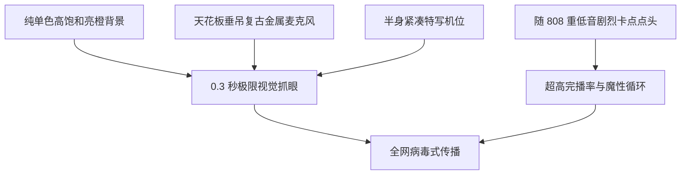

export const meta = {
  title: '如何用 AI 制作刷屏爆款《Hotel Lobby》橙色包厢说唱特效',
  description:
    '揭秘火爆全网的 TikTok 橙色包厢说唱风潮！全方位解析 Quavo & Takeoff《Hotel Lobby》与 Colors Show 经典视觉美学，手把手教你用 AI 一键生成悬吊麦克风、重低音卡点点头说唱短视频。',
  created_at: '2026-10-24',
  author_name: 'AIRapVideoFree 创作团队',
};

如果你最近在刷 TikTok、抖音、B站或小红书，你一定被这个画面刷屏过：一个极致纯净的高饱和度亮橙色纯色背景、一根从天花板垂直垂吊下来的复古录音棚麦克风、身穿 Oversize 连帽衫和璀璨大金链的主角，正随着硬核 Trap 鼓点疯狂点头晃脑，吐出如连珠炮般的地道街头押韵。

无论是让世界名画里的蒙娜丽莎、古代帝王、家里的金毛狗狗，还是科技界大佬的证件照“走进橙色包厢”，这种巨大反差感与魔性节奏都能在社交平台上斩获数百万点赞。

这正是风靡全球的 **《Hotel Lobby》AI 橙色包厢说唱特效**。它的原型来自于美国传奇说唱二人组 Quavo 与 Takeoff（Unc & Phew）2022 年在德国柏林知名音乐节目 **A COLORS SHOW** 上的现象级爆款现场表演。

在这篇深度教学中，我们将为你拆解《Hotel Lobby》美学的病毒式传播密码，并手把手教你如何用 [AIRapVideoFree 橙色包厢说唱特效](/effects/hotel-lobby-rap) 免费制作属于你自己的爆款视频。

---

## 为什么《Hotel Lobby》橙色包厢如此具有辨识度？

在短视频算法中，一条视频能否爆火，前 0.5 秒的视觉吸引力起到了生死攸关的作用。A COLORS SHOW 的这一经典构图蕴含了五大核心视觉密码：



### 1. 极致纯粹的无阴影橙色包厢
与普通 MV 复杂纷乱的灯光道具不同，Colors Show 剥离了一切多余干扰。整个录音棚由单一的高饱和度警戒橙色（International Orange）包裹，地面与背景墙浑然一体。这种极简环境让观众的视线在瞬间锁定在歌手的面容与穿搭上。

### 2. 天花板悬吊式复古麦克风（Ceiling-Suspended Mic）
没有笨重的落地麦克风架遮挡，仅有一根黑线垂下一枚银色大振膜电容麦克风。说唱歌手可以自由地绕着麦克风踱步、在重拍押韵时俯身贴近话筒，并在停顿间隙傲然仰头后撤，带来了生动自然的肢体动态。

### 3. 极具侵略性的重拍卡点点头（Head Bobbing）
Quavo 和 Takeoff 最具标志性的动作就是随节拍高频点头律动。配合 130 - 140 BPM 的 Trap 节奏，重音下沉、反拍抬颌，形成了一种近乎催眠的律动惯性，让人不自觉跟着点头并反复循环观看。

### 4. 街头服饰与珠宝的强烈反差
高明度的橙色背景堪称街头服饰的最佳画板：黑色机能卫衣、泛着冷光的粗大古巴项链、深黑太阳镜与手腕上的钻表，在漫反射橙光映射下质感极为高级。

---

## 为什么这一特效在短视频平台屡试不爽？

1. **信息流黄金 0.3 秒法则：** 在刷视频的过程中，用户的拇指以极快速度划过屏幕。这一抹耀眼的纯橙色能在 300 毫秒内被大脑识别，唤醒强烈的视觉记忆。
2. **“一本正经唱说唱”的反差幽默：** 当严肃的历史人物、萌宠猫狗、古典雕塑或普通职场人一本正经地戴上墨镜大金链、随低音猛烈点头说唱时，这种强烈的反差（Juxtaposition）带来了爆发式的幽默感和二次转发冲动。
3. **极佳的完播率与无缝循环：** 5 到 8 秒的短视频切片刚好对应一段精炼的双押 Hook 或 Punchline，观众往往还没看清脸部细节就已经不知不觉看了两三遍，直接拉满平台算法推荐指标。

---

## 一键实操：用 AI 制作《Hotel Lobby》橙色包厢视频

过去复刻这一特效需要复杂的 3D 换脸、绿幕抠像或繁重的 Stable Diffusion 模型训练。而在 [AIRapVideoFree](/effects/hotel-lobby-rap) 上，你只需上传一张照片，AI 便会自动完成一切。

### 第一步：准备一张合适的主角照片
为了达到最佳的生成质感，建议照片符合以下条件：
- **半身或胸部以上构图：** 人物面部与肩膀轮廓清晰。
- **正视镜头或微扬下巴：** 眼神直接看向镜头能够营造极强的舞台压迫感。
- **人物主体边缘分明：** 方便 AI 扩散模型将人物从原背景中精准剥离并置入橙色空间。

> **创意角色推荐：**
> - 戴墨镜的个人自拍照
> - 历史名画或古典雕塑肖像
> - 家中宠物（猫咪、柴犬、法斗）
> - 游戏角色截图或 3D 虚拟人头像

### 第二步：进入橙色包厢说唱特效专属页面
直接打开 AIRapVideoFree 的 [橙色包厢说唱特效（Hotel Lobby Rap Booth）](/effects/hotel-lobby-rap) 页面。

该特效后台已深度调优了专属于 Colors Show 视觉风格的 Prompt 提示词：

```text
Viral TikTok Colors Show studio: the person in the photo is standing in a vibrant monochromatic orange studio booth wearing an oversized designer hoodie and gold chains, aggressively nodding head and rapping into a vintage studio microphone hanging from the ceiling. Fast rhythm, head bobbing, street swagger, authentic hip-hop flow. Keep the person's exact face, facial features, hairstyle and skin tone recognizable. High definition, cinematic 9:16 vertical video.
```

### 第三步：生成与下载
- **画幅比例：** 默认设置为 `9:16` 竖屏，完美匹配抖音、TikTok、视频号。
- **视频时长：** 5 秒黄金循环时长。
- **模型支持：** 搭载 Kling 2.5 Turbo 与 Hailuo 2.3 顶级动态模型，确保人物面部不崩、头发与首饰随动作自然飘逸。

点击“生成”按钮，等待 30 秒，静态人物便会瞬间化身说唱巨星，在纯橙色录音棚中热血开唱！

---

## 高手进阶：剪映后期 808 低音卡点与震感合成

为了让你的短视频更有爆款相，可以将生成的视频导入剪映（CapCut）进行简单的音频卡点微调：

### 1. 节拍对齐（Beat Aligning）
- 导入一段 130 - 134 BPM 的硬核 Trap 说唱伴奏（例如经典的《Hotel Lobby》伴奏或 Suno 生成的音轨）。
- 将波形图放大，找到底鼓（Kick Drum）与 808 重低音爆发的波峰瞬间。
- 调整视频片段的起始时间，确保画面中人物头部向下猛点的一瞬间与 808 重击波峰完全重合。

### 2. 制作“超重低音镜头微震”物理冲击感
在 808 爆发的关键瞬间：
1. 在鼓点下落的第一帧，将视频画面放大至 `107%`。
2. 持续 3 到 4 帧后，画面恢复至 `100%`。
3. 在鼓点瞬间叠加轻微的“白色闪烁”滤镜（透明度 20%），并在音效库中加入微弱的低音破音轰鸣。
4. 这会产生录音室重低音喇叭瞬间震动摄像机感光元件的逼真物理动感。

### 3. 动态橙黑反差花字字幕
在纯橙色背景上，最醒目的字幕配色方案是：
- 主体文字：纯白字体，带轻微黑边投影（Drop Shadow）。
- 重点押韵词：荧光黄（#FFFF00）或青色（#00FFFF），每念到一个重音字词放大跳动，视觉节奏感拉满。

---

## 衍生创意：更多包厢色彩与玩法

掌握了经典橙色包厢后，你还可以在 [AI 说唱视频生成器](/tools/ai-rap-video) 中尝试以下进阶变体：

| 创意变体 | 提示词改动技巧 | 视觉风格体验 |
| :--- | :--- | :--- |
| **双人接力对唱** | `Two rappers standing side by side, passing the hanging mic` | 完美致敬 Quavo 与 Takeoff 经典互动 |
| **冰蓝冷冽 Drill 包厢** | `Replace monochromatic orange with freezing arctic neon blue` | 极寒伦敦钻头说唱暗黑氛围 |
| **赛博绿全息包厢** | `Lime green studio booth with subtle digital holographic scanlines` | 未来科技风 Trap Cypher |
| **流金奢华镜面棚** | `Metallic gold reflective studio walls, sparkling diamond reflections` | 奢华炫富风格爆款视觉 |

---

## 常见问题解答（FAQ）

### 使用这个特效会改变我原本的长相吗？
不会。AIRapVideoFree 采用了领先的面部特征保持技术，能够完整保留你的五官轮廓、眼神特征与发型走向，仅对穿搭、动作与背景进行嘻哈风格化迁移。

### 我可以给视频配上自己的声音或歌词吗？
完全可以！你可以录制一段自己的声音，或者使用 Suno、Udio 生成属于你的说唱 Verse，然后在剪映中将音频与视频合并，甚至使用对嘴工具进行更细致的口型校准。

---

## 立即走进属于你的橙色录音包厢

现在，爆款视觉密码已经全部掌握在你的手中。你不需要斥资搭建影棚，也不需要昂贵道具，只要一张照片：

- 立即进入 [橙色包厢说唱特效（Hotel Lobby Rap Booth）](/effects/hotel-lobby-rap) 开始创作。
- 探索更多风格，查看 [Drill 凶狠快嘴](/effects/drill-rap) 与 [赛博朋克地下说唱](/effects/cyberpunk-rap)。
- 查看 [20 个最强 AI 说唱视频提示词大全](/blog/best-ai-rap-video-prompts) 学习更多运镜技巧。
